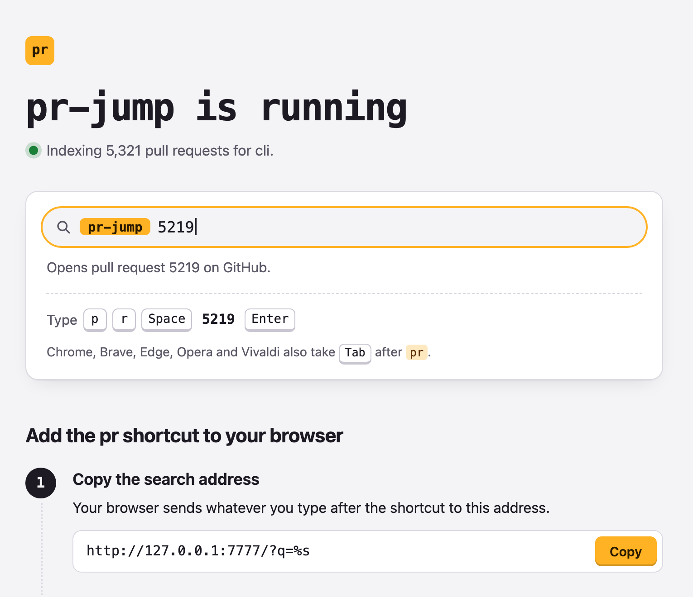

# pr-jump

[](https://github.com/beastawakens/pr-jump/actions/workflows/test.yml)
[](https://github.com/beastawakens/pr-jump/releases/latest)
[](LICENSE)

Type `pr 5219` in your browser's address bar and go straight to pull request #5219, whichever repository it is in.

<picture>
  <source media="(prefers-color-scheme: dark)" srcset="docs/setup-dark.png">
  
</picture>

pr-jump is a small local server that keeps an index of every pull request owned by the GitHub users and organisations you choose. Your browser sends the query to the server, which redirects you to the matching PR on GitHub. A PR that is already in the index opens in a few milliseconds, because the server does not need to ask GitHub.

| You type | You go to |
|---|---|
| `pr 5219` or `pr #5219` | the newest PR numbered 5219 in any indexed repository |
| `pr 42 ios`, `pr ios#42` or `pr ios/42` | PR 42 in the repository called `ios` |
| `pr acme/ios#42` | PR 42 in `acme/ios`, when several owners have an `ios` repository |
| `pr 42 v12` | PR 42 in the newest repository whose name contains `v12` |
| `pr flaky tests` | GitHub's PR search across your owners |

When several repositories have a PR with the same number, the newest PR wins. Small numbers are often shared by many repositories, so add part of the repository name to choose one.

## Install

### macOS and Linux, with Homebrew

```sh
brew install beastawakens/tap/pr-jump
```

### Windows, with Scoop

```sh
scoop bucket add beastawakens https://github.com/beastawakens/scoop-bucket
scoop install pr-jump
```

### Debian, Ubuntu, Fedora, Alpine and others

Download the `.deb`, `.rpm` or `.apk` package for your system from the [latest release](https://github.com/beastawakens/pr-jump/releases/latest), then install it:

- Debian and Ubuntu: `sudo apt install ./pr-jump_*_linux_amd64.deb`
- Fedora and RHEL: `sudo dnf install ./pr-jump_*_linux_amd64.rpm`
- Alpine: `sudo apk add --allow-untrusted ./pr-jump_*_linux_amd64.apk`, because the package is not signed

### With Go, or by hand

Run `go install github.com/beastawakens/pr-jump@latest`, or download the archive for your system from the [latest release](https://github.com/beastawakens/pr-jump/releases/latest) and put `pr-jump` somewhere on your `PATH`.

## Set it up

pr-jump needs the [GitHub CLI](https://cli.github.com/), signed in with `gh auth login`. That gives it a token with read access to your repositories. If your organisation uses SAML single sign-on, authorise the token for it.

Start pr-jump at login. Replace `my-org` with your GitHub organisation or username, and repeat `--owner` to index more than one:

```sh
pr-jump install --owner my-org --owner my-username
```

This checks the owners exist, then starts pr-jump straight away and at every login:

- on macOS, as a launch agent called `local.pr-jump`, logging to `~/.local/share/pr-jump/server.log`
- on Linux, as a systemd user service called `pr-jump`; see its log with `journalctl --user -u pr-jump -f`
- on Windows, from your Run registry key, logging to `%USERPROFILE%\.local\share\pr-jump\server.log`

The first index takes about a minute for 25,000 PRs. Until it finishes, lookups go to GitHub's search page instead.

Run `pr-jump install` again to change the owners or port, or after upgrading pr-jump so the new version starts. With Homebrew, run `brew update` before `brew upgrade`, or Homebrew may not see the new version for up to a day. To stop it starting at login, run `pr-jump uninstall`.

On Windows, Scoop cannot update pr-jump while it is running. Run `pr-jump uninstall`, then `scoop update pr-jump`, then `pr-jump install` with your owners again.

To run it in a terminal instead, without installing, run `pr-jump --owner my-org`. That can also use a `GITHUB_TOKEN` environment variable instead of the GitHub CLI. The login item cannot, because it does not see your shell's environment.

## Set up your browser

`pr-jump install` finishes by opening a setup page at `http://127.0.0.1:7777/`. It shows the steps for your browser, with a button to copy the address. Opening it also tells Chrome, Brave, Edge and Opera about pr-jump, so you only need to activate it in their settings and set its shortcut to `pr`. Firefox offers to add it from the address bar. Open the page again at any time; it also shows how many pull requests pr-jump has indexed.

Browsers do not let other programs change their search settings, so this last step is yours. The steps below do the same by hand.

Each browser needs a search shortcut that sends what you type after `pr` to this address:

```
http://127.0.0.1:7777/?q=%s
```

`%s` stands for what you type. If you chose another port with `--port`, change `7777` to match. You can use any shortcut you like instead of `pr`.

### Chrome, Brave, Edge and Opera

1. Open the search engine settings by typing one of these into the address bar:
   - Chrome: `chrome://settings/searchEngines`
   - Brave: `brave://settings/searchEngines`
   - Edge: `edge://settings/searchEngines`
   - Opera: `opera://settings/searchEngines`
2. Find site search (Chrome and Brave call it "Site search"), then select Add.
3. Fill in the form:
   - Name: `PR jump`
   - Shortcut (Opera calls it Keyword): `pr`
   - URL: `http://127.0.0.1:7777/?q=%s`
4. Save it.

To use it, type `pr`, then a space or Tab, then the PR number, then press Enter.

### Vivaldi

1. Open Settings, then Search.
2. Add a search engine:
   - Name: `PR jump`
   - Nickname: `pr`
   - URL: `http://127.0.0.1:7777/?q=%s`
3. Type `pr 5219` in the address bar.

### Firefox

Firefox uses bookmark keywords:

1. Open the bookmarks manager with Ctrl+Shift+O (Cmd+Shift+O on a Mac).
2. Choose Organise (Organize in US English), then Add bookmark.
3. Fill in the form:
   - Name: `PR jump`
   - URL: `http://127.0.0.1:7777/?q=%s`
   - Keyword: `pr`
4. Save it, then type `pr 5219` in the address bar.

### Safari

Safari cannot add custom search shortcuts on its own. You need a third-party Safari extension that supports keyword searches. Point it at the URL above.

### Why not just type the number?

Your browser only sends a bare number to your default search engine. You could make pr-jump your default, but then every search you type would go to GitHub's PR search, and searching would stop working whenever the server is not running. A two-letter shortcut avoids both problems.

## How it works

- On first start, pr-jump uses the GitHub GraphQL API to list every PR number, repository and creation date for your owners. It stores them in a SQLite file in `~/.local/share/pr-jump/` (or `$XDG_DATA_HOME/pr-jump/`). Choose another folder with `--data-dir`.
- Every 2 minutes, it asks the GitHub search API for PRs opened since the newest one it has. Change the interval with `--refresh`, for example `--refresh 5m`.
- Once a day, it rebuilds the whole index. This picks up repositories that were moved into your organisation and drops deleted ones. If a repository fails to load, its old entries stay, and the next rebuild runs 10 minutes later.
- If you ask for a number it does not have, it checks GitHub for new PRs before sending you to the search page. This takes a second or two, and happens at most once every 15 seconds. It never waits for a rebuild.

To rebuild the index straight away:

```sh
pr-jump --owner my-org --rebuild
```

Use the same owners as the running service, because each set of owners has its own index file. The running server picks up the new index straight away.

## Privacy and security

- The index holds only repository names, PR numbers and dates. It does not store titles, descriptions or code. It still lists private repository names, so pr-jump makes its data folder readable only by your account.
- The server listens only on `127.0.0.1`.
- It answers only navigations you start yourself, such as typing in the address bar. It refuses requests from web pages, which browsers mark with a `Sec-Fetch-Site` header, so other sites cannot probe the index. It also refuses any host name other than `127.0.0.1` or `localhost`, which blocks DNS rebinding.

## Development

pr-jump is a single Go program with one dependency, a pure-Go SQLite driver. Run the tests with:

```sh
go test -race ./...
```

The install tests use stand-ins for `launchctl`, `systemctl`, `reg` and `taskkill`, so they never change your login items. CI also installs pr-jump as a real login item on macOS, Linux and Windows, checks it answers, and removes it again.

To release, push a tag such as `v1.0.0`. GoReleaser builds every archive and package, publishes the GitHub release, and updates the Homebrew tap and Scoop bucket. It pushes to the tap and bucket with deploy keys stored in this repository's `HOMEBREW_TAP_DEPLOY_KEY` and `SCOOP_BUCKET_DEPLOY_KEY` secrets. Each key can write only to its own repository.

The macOS binary is not signed by Apple. The Homebrew cask removes macOS's quarantine flag so it can run.
